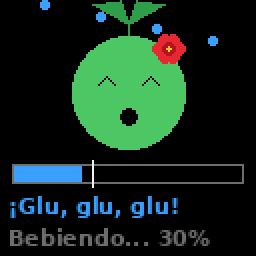
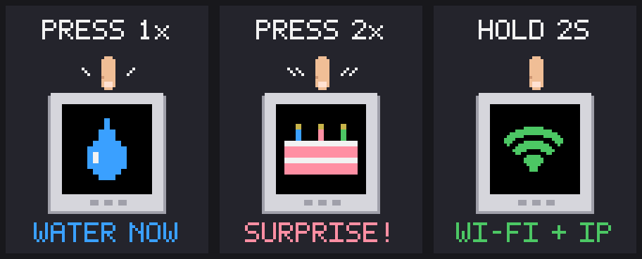

# Jardinerito 🌱

A little gardener for your plant: it checks the soil, waters from a jar by itself, shows how the plant feels and messages your iPhone.

| ¡Olé! | ¡Tengo sed! | ¡Glu, glu! | ¡Agua, por favor! | Siesta |
|:---:|:---:|:---:|:---:|:---:|
|  |  |  |  |  |
| happy | thirsty | drinking | refill the jar | night |

<p align="center"></p>

## Setup

Plug Jardinerito in with USB-C, then on a Mac (or Linux) computer:

```bash
git clone https://github.com/PerFrivik/jardinerito.git
cd jardinerito
./setup.sh
```

It walks you through everything, step by step: Wi-Fi, calibrating the sensor and iPhone notifications.

Good to know:
- **Push the sensor into the soil only up to the line printed on it.** The top part isn't waterproof.
- It only waters by itself after calibration, so it can never flood the plant by accident.
- Watering works without Wi-Fi. If it loses Wi-Fi, join `Jardinerito-Setup` (password `plantlove`) on your phone to pick a new one.
- Redo a single step any time: `./setup.sh calibrate` or `./setup.sh notify`.

## The button

<p align="center"></p>

Press once to water now (press again to stop). Hold for 2 s to see the address of the settings page.

## How it waters

When the soil is below 35 %, it pumps 3 s, then waits 15 min for the water to spread before checking again. At most 6 times a day, and the pump never runs longer than 15 s.
If watering 3 times in a row doesn't help, the jar is probably empty: refill it and press the button.
The screen dims from 22:00 to 07:00. All of these can be changed on the settings page.

## Modifying the software

The firmware is [ESPHome](https://esphome.io). Everything (screen drawing, watering logic, settings) is in [`jardinerito.yaml`](jardinerito.yaml).

```bash
./setup.sh flash                      # first time: installs the tools and flashes over USB
. .venv/bin/activate
esphome run jardinerito.yaml          # after that: build and update over Wi-Fi
```

`setup.sh` creates `secrets.yaml` with the password for wireless updates. Keep it, it's not in git.

Pins: pump = GPIO2, soil sensor = GPIO1 (Grove port), button = GPIO41. Screen SPI: CLK 15, MOSI 21, CS 14, DC 42, RST 48. Backlight: LP5562 on I2C (SDA 45, SCL 0, address 0x30).

It also shows up automatically in Home Assistant.
